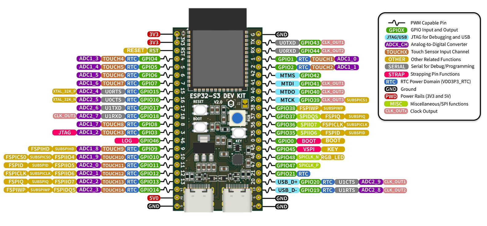
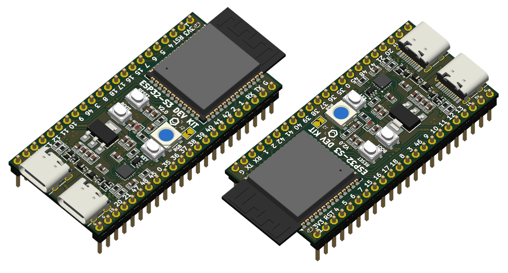
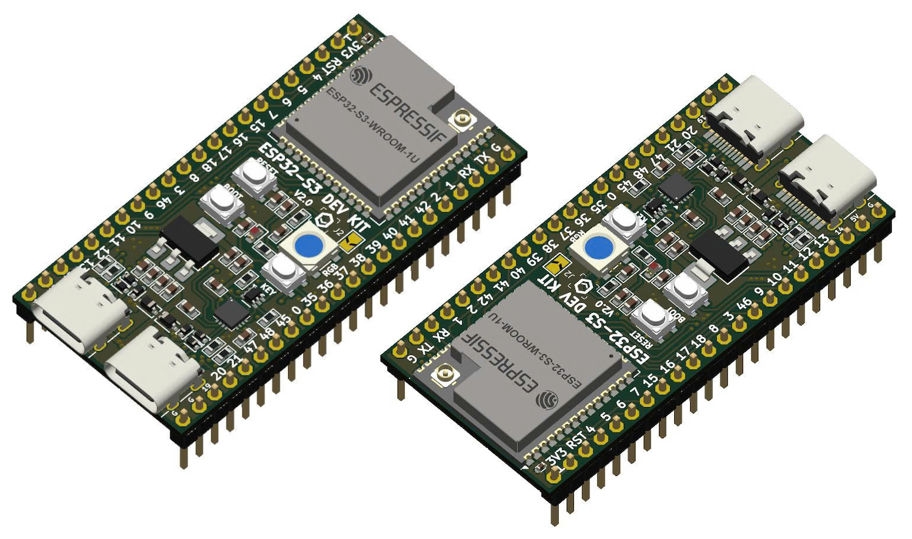
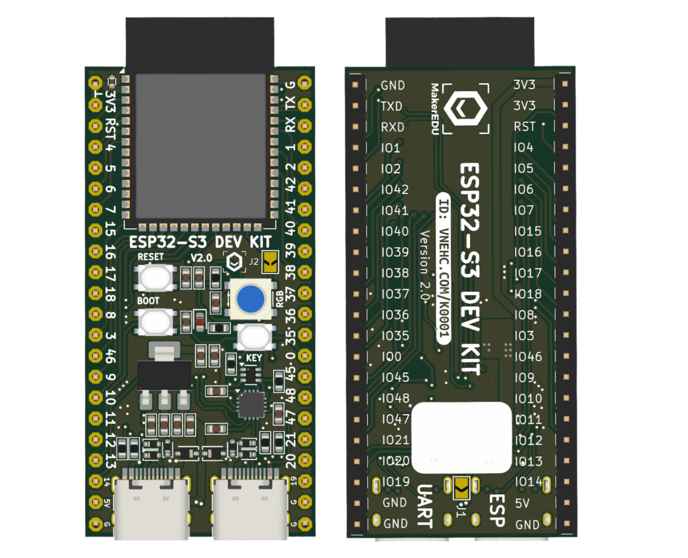

# Mạch phát triển mô đun MKE-K01 ESP32-S3 Dev Kit

## Giới thiệu
Mạch phát triển mô đun MKE-K01 ESP32-S3 Dev Kit là mạch phát triển ứng dụng dựa trên module [ESP32-S3-WROOM-1 chính hãng Espressif](/extras/esp32-s3-wroom-1-datasheet.pdf), được thiết kế tương thích với nguyên mẫu ESP32-S3 DevKitC-1, giúp người dùng tận dụng tối đa tài liệu, sơ đồ chân và phần mềm mẫu có sẵn. Sản phẩm tối ưu cho phát triển các dự án IoT, AIoT, nhúng và điều khiển với hiệu năng xử lý mạnh mẽ và kết nối linh hoạt.

**Ứng dụng thực tế:**
- Hệ thống IoT/Smart Home: điều khiển đèn, cảm biến từ xa
- AIoT/Computer Vision nhẹ: nhận dạng cơ bản trên thiết bị
- Thu thập dữ liệu không dây: sensor network, môi trường
- Robot điều khiển và giáo dục STEM
- Thiết bị điều khiển hiển thị/LED thông minh
- Gateway Protocols/Edge Devices

## Ưu điểm nổi bật
- Sử dụng module trung tâm [ESP32-S3-WROOM-1 chính hãng Espressif](/extras/esp32-s3-wroom-1-datasheet.pdf) và các linh kiện chính hãng chất lượng cao với 3 tùy chọn cấu hình bộ nhớ:
  - MCN4 – 4 MB Flash không PSRAM (phù hợp dự án cơ bản)
  - MCN16 – 16 MB Flash không PSRAM (nhiều chương trình hơn, chi phí thấp)
  - N16R8 – 16 MB Flash + 8 MB PSRAM (tối ưu cho ứng dụng AI/ML, buffer lớn)
- LED RGB tích hợp điều khiển bằng GPIO48
- Nút nhấn KEY tích hợp điều khiển bằng GPIO45 (phiên bản V2)
- Cổng USB OTG + USB-to-UART onboard giúp nạp chương trình dễ dàng và giao tiếp với máy tính
- Tích hợp đầy đủ chân GPIO breakout, tương thích thiết kế breadboard
- Hỗ trợ môi trường phát triển Arduino IDE, ESP-IDF, MicroPython

## Thông số kỹ thuật
- Nguồn hoạt động: 5VDC từ cổng USB
- Module trung tâm: [ESP32-S3-WROOM-1 chính hãng Espressif](/extras/esp32-s3-wroom-1-datasheet.pdf)
- Bộ nhớ Flash & PSRAM tùy chọn:
  - 4 MB Flash không PSRAM (MCN4)
  - 16 MB Flash không PSRAM (MCN16)
  - 16 MB Flash + 8 MB PSRAM (N16R8)
- IC giao tiếp USB-UART: High-speed Serial UART CH343P chính hãng có tốc độ truyền tối đa lên đến 6Mbp tương thích chuẩn USB 2.0, tự nhận Driver trên hầu hết các hệ điều hành.
- Cổng USB
  - Cổng USB-to-UART (MicroUSB/USB-C tùy phiên bản) dùng để cấp nguồn, nạp chương trình và giao tiếp debug
  - Cổng USB OTG full-speed (USB 1.1) trên chip ESP32-S3 hỗ trợ giao tiếp USB thiết bị/giao diện nếu phần mềm hỗ trợ
- GPIO và giao tiếp
  - Hầu hết chân GPIO của ESP32-S3 module được breakout ra header 2 bên, dễ dàng dùng cho các cảm biến/peripherals
  - Các chuẩn giao tiếp bao gồm: UART, SPI, I2C, I2S, PWM, ADC
  - Lưu ý: Một số chân (GPIO35/36/37) bị dùng bởi kết nối Flash/PSRAM trên module nên không dùng được ngoài
- Nút chức năng
  - RESET – khởi động lại MCU
  - BOOT (Download) – đưa board vào chế độ nạp firmware
  - KEY (tuỳ biến) - điều khiển bằng GPIO45 (phiên bản V2)
- LED chỉ báo
  - LED RGB addressable nằm trên board, được điều khiển qua GPIO48 giúp hiển thị trạng thái, debugging hoặc ánh sáng tùy chỉnh
  - LED Power 3.3 V bật khi board được cấp nguồn qua USB
- Giao diện lập trình: Arduino IDE, ESP-IDF, MicroPython
- Kích thước nhỏ gọn và thiết kế tiện cho prototyping

## Kích thước


## Sơ đồ chân


## Hướng dẫn sử dụng cơ bản với Arduino IDE
### Bước 1: Cài đặt Arduino IDE và cấu hình mạch
- Tải và cài đặt [Phần mềm Arduino IDE từ trang chủ Arduino](https://www.arduino.cc/en/software) phù hợp với hệ điều hành đang sử dụng.
- Sau khi cài đặt, chọn Tools → Board → Boards Manager, tìm từ khoá "esp32" để cài đặt cấu hình các mạch "esp32 by Espressif Systems".

### Bước 2: Kết nối mạch với máy tính
- Kết nối mô đun MKE-K01 ESP32-S3 Dev Kit với máy tính bằng cáp USB vào cổng USB-UART.
- Khi kết nối thành công, LED nguồn (ON) trên mạch sẽ sáng.
### Bước 3: Cài đặt driver CH340
- MKE-K01 ESP32-S3 Dev Kit sử dụng IC CH343P để giao tiếp USB–UART.
- Thông thường Driver sẽ tự nhận trên hầu hết các hệ điều hành, nếu máy tính chưa nhận driver, [tải và cài đặt Driver CH343P tại đây.](https://www.wch-ic.com/downloads/CH343SER_ZIP.html)
### Bước 4: Cấu hình mạch trong Arduino IDE
Thực hiện các thiết lập sau trong Arduino IDE:
- Chọn loại board: Tools → Board → esp32 → ESP32S3 Dev Module
- Cấu hình các thông số cần thiết như Flash Size, Partititon Scheme (theo phiên bản bộ nhớ Flash bạn đang sử dụng), PSRAM (nếu có chọn OPI PSRAM), các thông số khác có thể để ở mặc định. _(Lưu ý mục Upload Speed với Windows có thể chọn tốc độ 921600, tuy nhiên với MacOS hoặc các hệ điều hành khác nếu báo lỗi thì nên chọn 115200)_
- Chọn cổng kết nối (Port): Tools → Port → chọn cổng tương ứng với MKE-K01 ESP32-S3 Dev Kit (nếu chưa xác định được, hãy rút cáp USB và cắm lại để nhận diện cổng mới xuất hiện).

_Dưới đây là ví dụ cấu hình mạch ESP32-S3 16 MB Flash + 8 MB PSRAM (N16R8):_


### Bước 5: Nạp chương trình thử nghiệm (Hello World!)
Sau khi cấu hình xong, bạn có thể nạp chương trình mẫu `Hello World` để kiểm tra mạch, mạch có thiết kế chức năng nạp tự động nên không cần nhấn các nút Boot hoặc Reset.
```ino

void setup()
{
  // initialize serial communication at 115200 bits per second:
  Serial.begin(115200);
}

void loop()
{
  // print out
  Serial.println("Hello World!");
  // delay 1s
  delay(1000);
}
```

Chương trình này sẽ hiển thị chữ "Hello World!" lên Serial Monitor của Arduino.

## Lưu ý sử dụng an toàn
- Không đặt mạch trên bề mặt kim loại dẫn điện
- Tránh môi trường:
  - Ẩm ướt
  - Nhiệt độ cao
  - Nhiều bụi dẫn điện
- Nên sử dụng với nguồn điện chất lượng tốt
- Luôn đảm bảo mạch:
  - Không bị chập mạch
  - Không đấu sai cực nguồn
- Nên ngắt nguồn trước khi thay đổi đấu nối phần cứng.

## Hình ảnh sản phẩm



## Miễn trừ trách nhiệm
Sản phẩm này là mô đun phát triển được thiết kế phục vụ cho mục đích nghiên cứu, thử nghiệm và học tập, không phải là một thiết bị hoàn chỉnh. Trong trường hợp người dùng kết hợp mô đun này với các linh kiện, thiết bị hoặc phần mềm khác để tạo thành một hệ thống hoặc sản phẩm hoàn chỉnh, mọi chức năng và tính phù hợp của sản phẩm sau cùng đều thuộc trách nhiệm của người dùng.
